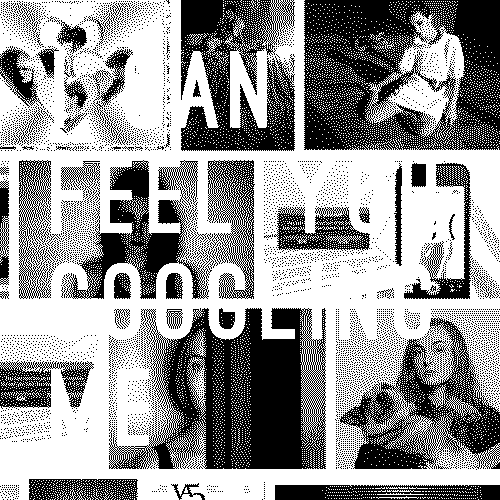
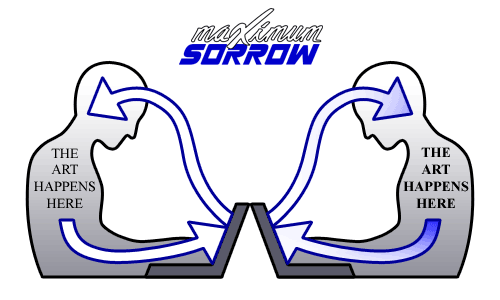

# Hi, I’m Krystal AKA @ksouth. 
Artist, writer, mum, nerd, autodidact, animal and plant enthusiast, physically disabled AuDHDer, book collector, amateur archivist, jack of many trades, master of none. From Portland, Oregon, USA. Now in Melbourne, Victoria, Australia. 

Portfolio? Site: [krystalsouth.com](https://krystalsouth.com) 
*Identify Yourself*, my book and website about growing up online, written 2013.: [idyrself.com](https://idyrself.com) 
It will always be Twitter: [@ksouth](https://x.com/ksouth) 
Substack: [krystalsouth.substack.com](https://krystalsouth.substack.com/) 
Instagram: [@KrystalSouth](https://www.instagram.com/Krystalsouth) 
LinkedIn: [krystalsouth](https://www.linkedin.com/in/krystalsouth/) 
YouTube: [@KrystalSouth](https://www.youtube.com/@KrystalSouth) 
 
I keep a [public repository dashboard](https://ksouth.github.io/ksouth/), [a list of the repositories I created](https://ksouth.github.io/ksouth/created/), and a day-by-day [log of new repos and stars from people I follow.](https://ksouth.github.io/ksouth/feed/) I love [adding stars to topical lists](https://ksouth.github.io/ksouth/lists/) to gather repos aligned with my interests like [AI](https://ksouth.github.io/ksouth/lists/ai/), [archiving](https://ksouth.github.io/ksouth/lists/archiving/), and [art](https://ksouth.github.io/ksouth/lists/art/). 
 
I've been on GitHub since 2013 but I am only now learning how to use it!!!! I love to see what people are creating with code and data. I'm a Mac OSX/iOS user and only really know html and css but I am exploring new languages with AI, for better or worse. 

## <a href="mailto:&#107;&#114;&#121;&#115;&#116;&#97;&#108;&#115;&#111;&#117;&#116;&#104;&#64;&#112;&#109;&#46;&#109;&#101;">Please reach out</a> if you have any questions, inquiries, opportunities, ideas, whatever.

  

  <em>I Can Feel You Googling Me</em>, <a href="https://krystalsouth.com/">Krystal South</a>, Animated .GIF, November 2013. 
  Part of: <a href="https://thewrong.org/2013-14">The Western Digital pavilion</a>, curated by <a href="https://ricksilva.net/">Rick Silva</a> for <a href="https://thewrong.org/">The Wrong Biennale</a>.

<table>
  <tr>
    <td width="50%" align="center" valign="top">
       
      <em><a href="https://www.kevinbewersdorf.org/websites/maximumsorrow/index.html">Maximum Sorrow</a></em>, <a href="https://www.kevinbewersdorf.org/">Kevin Bewersdorf</a>, Animated .GIF, 2008&ndash;2009.
    </td>
    <td width="50%" align="center" valign="top">
       
      <em><a href="https://www.etsy.com/au/listing/563405431/never-log-off-t-shirt">Never Log Off</a></em>, <a href="https://benaqua.org/info">Ben Aqua</a>, Animated .GIF, 2013.
    </td>
  </tr>
</table>

<!-- card row, awaiting KS sign-off:

  
  

-->

<!--
 
-->
